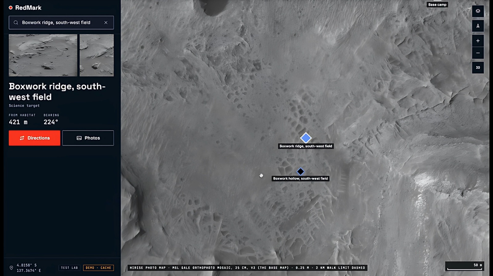
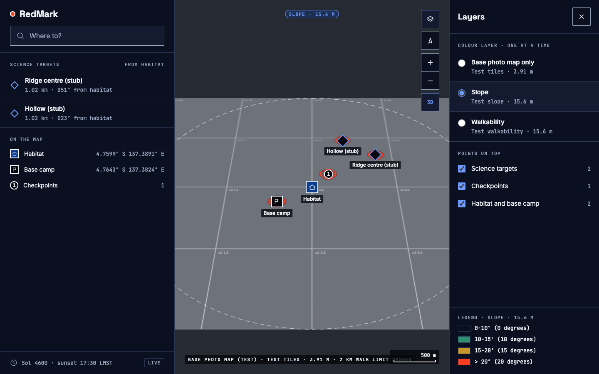
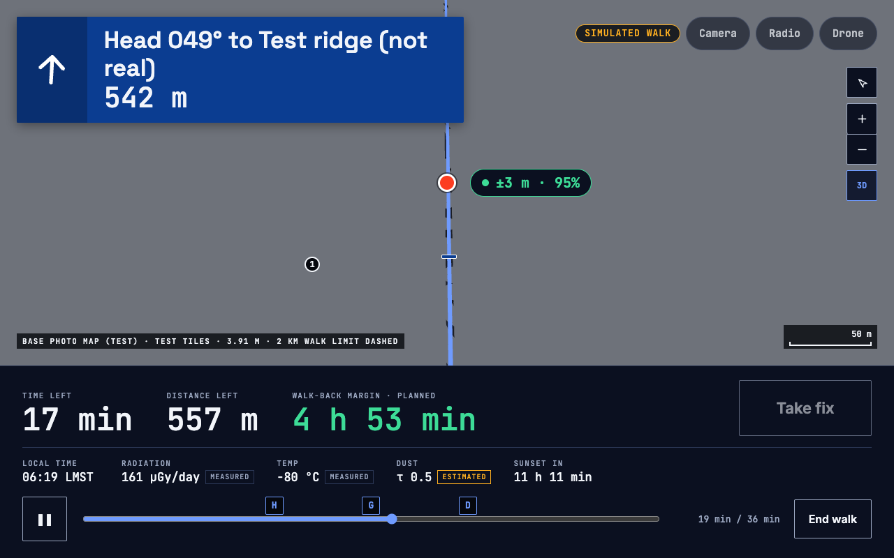
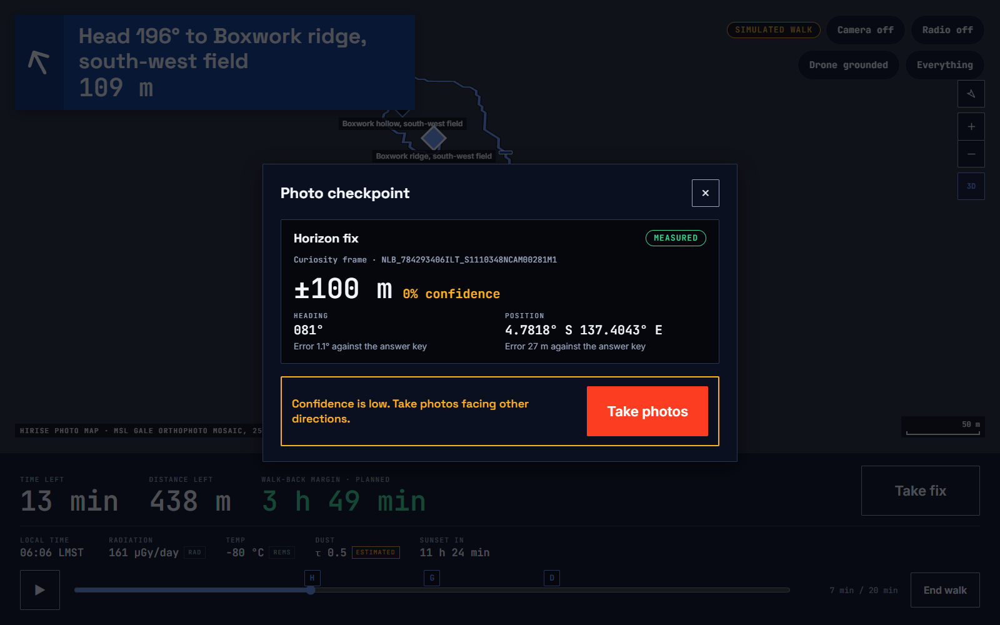
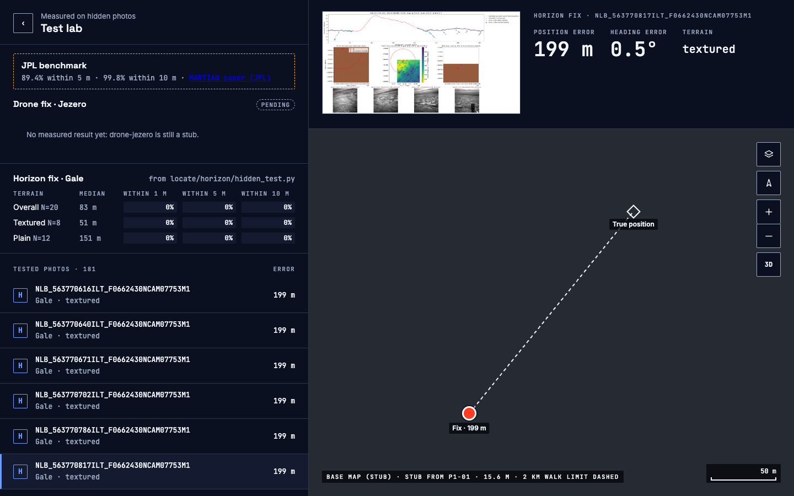

# RedMark

**A layered Mars walk map that finds the crew's position from photos, with no GPS.**

Built in 24 hours by a team of four for the **NASA Space Apps Challenge 2026**, challenge [Interplanetary Survival Guide: Martian Map](https://www.spaceappschallenge.org/2026/challenges/interplanetary-survival-guide-martian-map/).

## Demo



## The problem

Mars has no GPS and no magnetic field to point a compass. A message to Earth can take up to 24 minutes each way. A crew that can't find its own position offline can't safely walk far from the habitat.

RedMark plans a two-person walk into the **Gale crater boxwork on Mount Sharp**, to a ridge and a hollow Curiosity never reached. It follows the crew along the way and tells them where they are from photos. Every position comes with an honest **uncertainty circle**, and the map shows where a photo fix will be reliable and where it won't.

## What it does

The tablet app has eight screens: planning, walk view, photo checkpoint, drone fix, target preview, lost mode, a test lab for judges, and simulation controls with "break it" buttons (camera off, radio off, drone grounded).

| Plan in 3D | Walk view |
| --- | --- |
|  |  |
| **Photo checkpoint: horizon fix** | **Test lab** |
|  |  |

## How it works

1. **Five map layers from NASA data.** Base map and slope come from the HiRISE 25 cm photo map and 1 m 3D terrain. Walkability comes from THEMIS thermal inertia and a ridge map drawn from the 25 cm photos. Science comes from CRISM minerals and Curiosity APXS chemistry. Conditions come from Curiosity RAD radiation and REMS weather on a replayed sol (4600). The fifth layer, location quality, is our own.
2. **Location quality.** For every 1 m cell of the walk area, this layer combines the line of sight to four landmarks (the upper Mount Sharp peak, the buttes Texoli and Mishe Mokwa, and the Gale crater rim) with the error our horizon test measured on that kind of ground. It tells the crew and the planner where a photo fix will be good.
3. **Fastest safe route.** The planner finds the minimum-cost path over walking time, ridge crossings and location quality. It works under hard limits from NASA's Artemis walk planning: 20° slope, 2 km from the habitat, about 6 h, and enough time left to walk home from any point. A science alternative passes more targets, and the cart gets its own route to a base camp.
4. **Position from photos.** RedMark matches the skyline in a helmet photo against skylines rendered from 3D terrain out to 120 km, which gives a heading and a rough position. Drone photos are matched straight down against the photo map, using LoFTR weights JPL trained for HiRISE-scale maps. Every fix shows an uncertainty circle, never a single point.
5. **Lost mode.** If the crew loses its way, RedMark gives the way home in landmark words for every leg, such as "Keep the upper Mount Sharp peak on your left".

## Results

Each test was run on photos the matcher never saw, against true positions from Curiosity's localizations.

| Test | Photos | Median error | Notes |
| --- | --- | --- | --- |
| Horizon fix, Gale (Curiosity Navcam) | 20 | 83 m, heading 0.8° | 51 m on textured ground, 151 m on plain ground, 262 m in hollows; about 4 s per fix |
| Ground fix attempt, Gale (stage 2) | 40 | 22 m | 32.5% within 5 m |
| Ground fix, Gale | 40 | 0.34 m | **Simulated** |
| Drone fix, Jezero (Ingenuity) | — | pending | JPL's benchmark: 89.4% within 5 m, 99.8% within 10 m |

Every number comes from a results file in [`results/`](results/) that records the script, commit and input checksums that wrote it. The app labels every simulated result **Simulated**.

## Run it

You need [uv](https://docs.astral.sh/uv/) (Python 3.11) and Node 22 LTS.

```bash
uv sync
npm ci --prefix app
uv run pytest tests/smoke                   # contracts, service and app build
```

**Offline demo.** The app can replay the whole demo from the recorded cache in [`cache/demo/`](cache/demo/), with the network off and no service running:

```bash
npm run dev --prefix app
```

Open the address Vite prints, then set the switch to **Demo** (the choice stays after a reload). Routes, walks, fixes and the test lab all replay from the cache. The demo walk is the fastest route to the south-west boxwork ridge at the 20° slope limit, recorded for every break-it scenario. The photo map behind them needs the service and the data folder (below); without them, the map shows the markers on a plain background.

**Live mode** runs the route planner and simulation through the local service:

```bash
uv run uvicorn service.app:app --reload     # service on http://127.0.0.1:8000
npm run dev --prefix app                    # the app, in Live mode
```

The photo-map tiles come from the data folder named by `REDMARK_DATA`. Without it, RedMark uses the small stub data in [`contracts/stubs/stub-data/`](contracts/stubs/stub-data/). To build the real data folder, run the scripts in [`prep/`](prep/). They download and crop the public NASA files listed in each folder's `data-manifest.yaml`. The full HiRISE photo map is about 50 GB.

## Repository map

| Folder | What's in it |
| --- | --- |
| [`app/`](app/) | React 19 + deck.gl tablet app (Vite, TypeScript) |
| [`service/`](service/) | Local FastAPI service the app talks to |
| [`prep/`](prep/), [`sites/`](sites/) | Data crops and map layers 1–3, site configs |
| [`locate/`](locate/) | Position finding: horizon, ground and drone matchers |
| [`layers/location_quality/`](layers/location_quality/) | Layer 5, location quality and the landmark directions |
| [`route/`](route/), [`sim/`](sim/), [`conditions/`](conditions/) | Route planner, walk simulation, the replayed sol |
| [`contracts/`](contracts/) | JSON Schemas between the four parts, with generated Python and TypeScript types |
| [`results/`](results/), [`cache/`](cache/) | Test results with provenance, and the offline demo cache |
| [`docs/`](docs/) | [Project document](docs/project-document.md), [team plan](docs/team-plan.md), per-person plans, screenshots |

Words like *fix*, *heading* and *uncertainty circle* each have one meaning, set in [GLOSSARY.md](GLOSSARY.md). To contribute, start with [AGENTS.md](AGENTS.md).

## NASA data

RedMark uses data from ten NASA instruments on five missions: Mars Reconnaissance Orbiter, Mars Global Surveyor, Mars Odyssey, Curiosity, and Mars 2020's Ingenuity. All of it is public through PDS and USGS Astrogeology.

| Data | Instrument / mission | Used for |
| --- | --- | --- |
| MSL Gale merged orthophoto mosaic, 25 cm | HiRISE, MRO | Base map, ridge map, drone and ground matching |
| MSL Gale merged DEM, 1 m | HiRISE stereo, MRO | Slope, skylines, landmark visibility |
| HRSC and MOLA blended DEM, 200 m | MOLA, MGS (with ESA's HRSC) | Far skyline: Mount Sharp and the crater rim |
| THEMIS thermal inertia mosaic, 100 m | THEMIS, Mars Odyssey | Walkability: loose sand vs rock |
| CRISM MTRDR summary parameters, FRT0000B6F1 | CRISM, MRO | Mineral layer, science targets |
| MSL APXS concentrations, sols 3193–4133 | APXS, Curiosity | Chemistry layer along the rover's track |
| RAD calibrated RDR, sol 4600 | RAD, Curiosity | Radiation on the replayed sol |
| REMS MODRDR, sol 4600 | REMS, Curiosity | Temperature and pressure on the replayed sol |
| MSL PLACES rover localizations | Curiosity | True positions for testing photo fixes |
| MSL Navcam frames and mosaics | Navcam, Curiosity | Test photos for horizon and ground fixes; landmark check |
| Curiosity raw images (Mastcam sol 4600, Navcam sol 4605) | Mastcam, Navcam | Target preview pictures |
| Jezero HiRISE orthomosaic, 25 cm | HiRISE, MRO | Map for the drone test at Jezero |
| Mars 2020 Helicopter Camera bundle | Ingenuity | Drone test photos |
| Ingenuity flight paths (MMGIS) | Ingenuity | Flight positions for the drone test |

Walk limits come from NASA's Artemis EVA planning studies (NTRS 20210000827, NTRS 20210026296, EVA ConOps). Landmark names come from NASA's Navcam mosaic PIA26632. Every external file is listed with its source link and checksum in the `data-manifest.yaml` files.

## Credits

**Space agency partner data.** ESA: the far terrain blends HRSC (High Resolution Stereo Camera, Mars Express) with MOLA. Fergason, R. L., Hare, T. M. and Laura, J. (2018), *HRSC and MOLA Blended Digital Elevation Model at 200 m v2*, USGS Astrogeology Science Center.

**Data.**
- Calef, F. J. III and Parker, T. (2016), MSL Gale Merged DEM 1 m v3 and Merged Orthophoto Mosaic 25 cm, USGS Astrogeology Science Center; HiRISE: NASA/JPL-Caltech/University of Arizona.
- THEMIS quantitative thermal inertia mosaic: USGS Astrogeology Science Center; THEMIS: NASA/JPL-Caltech/Arizona State University.
- CRISM MTRDR (MRO-M-CRISM-5-RDR-MPTARGETED-V1.0): NASA/JPL-Caltech/JHU-APL, PDS Geosciences Node.
- MSL APXS RDR (MSL-M-APXS-4/5-RDR-V1.0): NASA/JPL-Caltech, PDS Geosciences Node.
- MSL RAD team; NASA PDS, MSL-M-RAD-3-RDR-V1.0.
- Gomez-Elvira et al.; NASA PDS MSL-M-REMS-5-MODRDR-V1.0, doi:10.17189/ghbc-qr41.
- MSL PLACES localization archive, MSL Navcam reduced data records and mosaics: NASA/JPL-Caltech, PDS Imaging Node.
- Curiosity raw images: NASA/JPL-Caltech/MSSS.
- Mars 2020 TRN HiRISE orthomosaic of Jezero crater: USGS Astrogeology Science Center; HiRISE: NASA/JPL-Caltech/University of Arizona.
- Mars 2020 Helicopter Camera bundle, NASA PDS Imaging Node; Ingenuity flight paths, NASA/JPL-Caltech (MMGIS).

**Models and code we didn't write.**
- LoFTR weights fine-tuned by JPL for HiRISE-scale maps (Apache-2.0, Copyright California Institute of Technology): Pisanti, D., Hewitt, R., Brockers, R. and Georgakis, G. (2026), *Geometry-aided Vision-based Localization of Future Mars Helicopters in Challenging Illumination Conditions*, [arXiv:2502.09795](https://arxiv.org/abs/2502.09795). LoFTR: [zju3dv/LoFTR](https://github.com/zju3dv/LoFTR).
- DISK: Tyszkiewicz, M., Fua, P. and Trulls, E. (2020), NeurIPS.
- LightGlue: Lindenberger, P., Sarlin, P.-E. and Pollefeys, M. (2023), ICCV ([cvg/LightGlue](https://github.com/cvg/LightGlue), weights via Kornia).
- JPL's drone-fix benchmark: the [MARTIAN paper](https://arxiv.org/html/2605.29647).
- Libraries: Python, NumPy, SciPy, rasterio and GDAL, Matplotlib, FastAPI, Pydantic, PyTorch, Kornia, PyYAML, jsonschema, pytest, Ruff; React, deck.gl, Vite, TypeScript, Vitest; Fontsource fonts (Inter, Space Grotesk, JetBrains Mono).

**Use of AI.** We used AI coding agents (Anthropic's Claude Code, with OpenAI Codex as a code reviewer) to write most of the code, under our direction. Each ticket ran in its own branch through a test-first cycle built on [mattpocock/skills](https://github.com/mattpocock/skills). A person agreed each ticket's design, checked every map result by eye on an overlay image, and reviewed and merged every change. Every result comes from NASA data run through our code, not from a model.

## Team

Built by a team of four at NASA Space Apps 2026:

- [@s1lentOf](https://github.com/s1lentOf): app, service and submission
- [@H0lmy](https://github.com/H0lmy): data and drone matcher
- [@Arsenii-Zagriichuk](https://github.com/Arsenii-Zagriichuk): horizon matcher and location quality
- [@Maksym926](https://github.com/Maksym926): route and simulation
