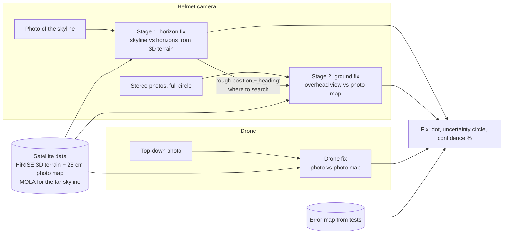
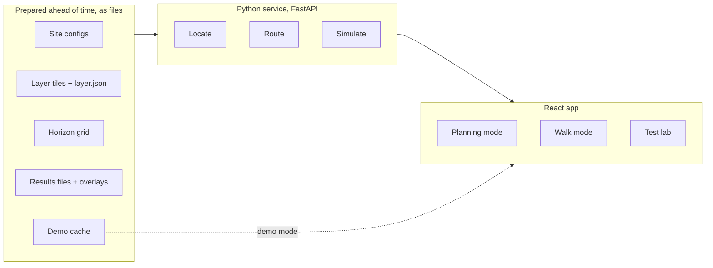

# RedMark — Project Document

Nov 12, 2026 · @Maksym Shtymak · updated Nov 13, 2026

How the team builds this in 24 hours, who owns what and the tickets are in the [team plan](team-plan.md). Where this document and the team plan differ on scope, the team plan wins.

## Overview

RedMark is a layered Mars walk map with "GPS without satellites" built in. The crew plans the fastest safe route to the next science target, then takes a photo on the way and sees "you are here, ±X m". It answers the NASA Space Apps challenge [Interplanetary Survival Guide: Martian Map](https://www.spaceappschallenge.org/2026/challenges/interplanetary-survival-guide-martian-map/) with three parts:

- **Five data layers**: base map and slope, walkability, science, conditions, and location quality.
- **Route planning**: the fastest safe route, which also stays where position finding works well.
- **Position finding**: matches helmet-camera and drone photos against NASA satellite maps and 3D terrain.

What sets RedMark apart is **photo-based position finding** and the **location-quality layer** it produces (where the system knows your position well, and where it doesn't). Other teams already plan routes with terrain uncertainty in mind ([one public entry](https://github.com/MONSTER4REX/Martian-Map)), so careful routing alone is not unique. RedMark's route reacts to position uncertainty: it moves away from hazards when the system is less sure where you are.

The demo mission is a walk into the Gale crater boxwork on Mount Sharp by two astronauts, a robotic cart and a small drone. NASA's challenge text gives a boxwork mission at Mount Sharp as its own example, so the site fits the brief, and other teams may pick it too. A team of 4 builds it in 24 hours.

**What is real in the 24-hour build.** The map, the layers and the route planner (walkers, science alternative and cart) are real. The real position results are a horizon fix at Gale (heading and rough position) and drone fixes at Jezero. The precise ground fix at Gale gets one real attempt; if it fails by hour 12 it stays simulated. The drone fix at Gale is simulated. Everything simulated is labelled that way.

## Problems we found and how the design fixes them

The original idea (match astronaut photos to satellite photos, then route from A to B as fast as possible) had eleven holes. Each one shaped a design decision.

| Problem | Why it matters | RedMark's answer |
| --- | --- | --- |
| Ground photos look sideways; satellite photos look straight down | Direct matching between the two is unreliable | Two stages: horizon vs 3D terrain, then a stereo overhead view vs the photo map. Drone photos already look down. |
| No GPS and no compass on Mars | Heading is unknown as well as position | Horizon and sun give heading; motion sensors and visual odometry track movement between fixes |
| Rover photos only cover rover tracks | Nothing to match against away from the tracks | Satellite data is the source of truth; rover photos only tune and test the matcher and build the error map |
| "100% sure" is impossible | False confidence is dangerous | Uncertainty circle with a confidence %, and extra photos when unsure |
| "As fast as possible" conflicts with safety | Safety is NASA's first priority in the challenge | Fastest *safe* route, with hard limits and a walk-back rule |
| Map sharpness varies | 1 m 3D terrain barely sees the 1–2 m boxwork ridges | Ridge map drawn from 25 cm photos; the app shows each layer's sharpness |
| The challenge wants science and at least 3 data types | Navigation alone misses the brief | Five layers, including minerals and science targets |
| No live link to Earth | Messages take 4–24 minutes each way | Everything runs offline on the tablet; the habitat double-checks when connected |
| No astronaut photos exist | Nothing real to demo with | Curiosity photos at Gale and Ingenuity photos at Jezero as stand-ins |
| Drone flights are short and fail over bland sand | A drone can't be the only source | The drone is an addition; the helmet camera is always available |
| Drone photos are about 7 times sharper than the satellite map | Standard matchers struggle across that resolution gap | Matcher weights JPL trained for HiRISE-scale maps; photos shrunk to map scale; a 5–10 m target for drone fixes |

## Mission scenario

Two astronauts, a robotic cart and a drone walk into the Gale crater boxwork on Mount Sharp to sample ridges and hollows outside the strip Curiosity explored.

- **Site**: the boxwork is a network of low ridges, about 1–2 m tall, with sandy hollows between them ([Space.com](https://www.space.com/space-exploration/mars-rovers/curiosity-rover-finds-clues-to-mars-watery-past-in-rocky-spiderwebs)). The pattern stretches 10–20 km across Mount Sharp ([NASA Photojournal](https://photojournal.jpl.nasa.gov/catalog/PIA26552)). Curiosity entered the boxwork layer in May 2025 ([GSA 2025 abstract](https://gsameetings.secure-platform.com/connects25/solicitations/103002/sessiongallery/schedule/items/95386/application/10634)) and left it in late March 2026, driving on into the layered sulfate unit to the south ([NASA blog](https://science.nasa.gov/blog/curiosity-blog-sols-4845-4851-bye-bye-boxwork-bye-bye/)).
- **Why this site**: strong horizon landmarks. From the boxwork you can see the buttes "Mishe Mokwa" and "Texoli", the peak of upper Mount Sharp, and the rim of Gale crater ([NASA](https://science.nasa.gov/photojournal/curiosity-captures-mars-landscape-while-talking-to-an-orbiter)). HiRISE 3D terrain at up to 1 m spacing covers this part of Mount Sharp ([Fraeman et al.](https://pmc.ncbi.nlm.nih.gov/articles/PMC5101845)), and Curiosity took about ten months of photos here with known positions. NASA's challenge text also gives a boxwork mission at Mount Sharp as its example.
- **Crew**: two astronauts walking together, following NASA's buddy rule. Two helmet cameras give two position fixes at the same moment. Both use the same map, so they cross-check each other but are not fully independent.
- **Cart**: carries the drone, spare batteries, tools and samples. It drives a cart-safe route (it can't climb 1–2 m ridges) and parks at a **base camp** on firm, open ground.
- **Drone**: Ingenuity-class. It launches from the base camp for top-down position fixes, path scouting, target previews and lost-astronaut search. Flights last under 3 minutes, so the drone is not a radio relay.
- **Science goal**: test whether Curiosity's boxwork findings hold beyond its track. From July 2025 to February 2026 the rover studied the best-defined ridges and hollows and picked a ridge and a hollow to drill ([NASA blog](https://science.nasa.gov/blog/curiosity-blog-sols-4804-4811-kicking-off-the-final-phase-of-boxwork-exploration)), all inside one strip of the pattern. The crew samples one ridge centre and one hollow at places the rover did not reach, and compares them with Curiosity's results to test the ancient-groundwater story.
- **Time**: one real day (sol) from Curiosity's boxwork campaign (May 2025 to March 2026) is replayed. Its real radiation, weather and sun position are the "live" conditions.

Open question: the exact habitat spot and walk area. Pick them during data prep, inside the Gale merged mosaic and DEM, and off Curiosity's track. Check the final choice against Curiosity's full traverse, so that no science target is a spot the rover already drilled.

## How RedMark finds your position

Satellite data is the source of truth. Photos from the helmet and the drone are matched against it in two stages, from rough to precise.

Stage 1 tells stage 2 where to search; drone fixes run alongside whenever the drone can fly.

**Source of truth.** Existing NASA maps: HiRISE 3D terrain (about 1 m per height point) and the HiRISE photo map (about 25 cm per pixel). At Gale the team uses the [MSL Gale merged orthophoto mosaic](https://astrogeology.usgs.gov/search/map/mars_msl_gale_merged_orthophoto_mosaic_25cm) and the [merged DEM](https://astrogeology.usgs.gov/search/map/mars_msl_gale_merged_dem_1m). Curiosity's recorded positions use the same map frame, so the answer key and the map line up; the team checks this by plotting rover positions on the map during prep. The team uses published files and does not build its own 3D terrain. The merged DEM covers about 137.12–137.68°E and 4.13–5.10°S (33 × 57 km), so the top of Mount Sharp and most of the crater rim are outside it. The far skyline therefore comes from the [MOLA global terrain model](https://planetarymaps.usgs.gov/mosaic/Mars_MGS_MOLA_DEM_mosaic_global_463m.tif) at 463 m.

**Stage 1: horizon (rough position + heading).** The helmet camera's skyline is compared with horizon lines calculated from the 3D terrain at candidate spots. The result is a rough position and the heading, the direction the astronaut is facing. JPL reports that horizon-style methods typically reach about 100 m, at best 10 m ([JPL, ICRA 2024](https://www-robotics.jpl.nasa.gov/media/documents/2024_Global_Localization_ICRA.pdf)). That's why stage 1 only narrows the search. Its most reliable output is heading. Mars is small enough that its curvature matters here: 60 km away, the surface sits about 530 m below a flat plane, about half a degree on the skyline, so the calculated horizons include it. In a hollow, the nearby 1–2 m ridges can hide the skyline, and the 1 m terrain barely shows them, so horizon checkpoints sit on ridge tops or open ground.

**Stage 2: ground (precise position).** At checkpoints, the astronauts turn a full circle with the stereo helmet camera, or split the circle between them. The stereo photos become an overhead view of the nearby ground, which is matched to the 25 cm photo map. JPL's onboard version of this method reached sub-meter accuracy on 264 real Perseverance locations ([JPL, ICRA 2024](https://www-robotics.jpl.nasa.gov/media/documents/2024_Global_Localization_ICRA.pdf)), and it was first used on Mars on Feb. 2, 2026 ([NASA](https://science.nasa.gov/?p=1201140)). The boxwork ridge pattern acts like a fingerprint from above. In the 24-hour build the team makes one real attempt at this stage at Gale; if it isn't working by hour 12, it stays simulated (see Testing and accuracy).

**Drone fix.** The drone launches from the base camp and takes a top-down photo that includes the astronauts. The photo is matched to the photo map, and the app finds each astronaut by the bright markers on their helmet and backpack. Each marker's spot in the photo becomes map coordinates. Ingenuity's navigation camera covered about 3.6 cm of ground per pixel from 10 m up ([Maki et al., LPSC 2025](<https://epizodyspace.ru/bibl/inostr-yazyki/Lunar_and_Planetary_Science/2025/Maki_et_al_Ingenuity_Mars_Helicopter_Cameras_56th_LPSC_no_2685_(2025).pdf>)), much sharper than the map.

**The resolution gap.** A drone photo is about 7 times sharper than the 25 cm map. JPL found that template matching and hand-made features struggle across that gap ([Georgakis et al.](https://orbilu.uni.lu/handle/10993/66967)). RedMark shrinks each photo to map scale and starts from matcher weights that JPL trained on HiRISE-scale maps ([Hugging Face](https://huggingface.co/dpisanti/mbl-mars)). JPL's own fine-tuned system placed 89.4% of Ingenuity frames within 5 m and 99.8% within 10 m ([MARTIAN paper](https://arxiv.org/html/2605.29647)), so the target for a drone fix is 5–10 m.

**Rover photos.** Curiosity photos with known positions are split into two piles: one tunes the matcher, the other stays hidden and tests it. The split is by stretch of the traverse, not by sol, because the rover often stays parked for several sols and would otherwise put photos of the same spot in both piles. Test results by area become the **error map**, which feeds the confidence number and the location-quality layer.

**What the astronaut sees.** A dot with an uncertainty circle and a confidence %. When confidence is low, the app asks for photos facing other directions.

**Accuracy limits.** The photo map's pixels are 25 cm. Rover positions were themselves set by matching to the same map, so tests can't prove much better than about 1 m. Design targets for a real mission:

- Under 5 m everywhere, enough to know which 10–20 m hollow you're in.
- About 1 m on textured ground, enough to record where a sample came from.

What the 24-hour build can show:

- Horizon fix at Gale: heading error in degrees and position error in metres, as measured. Published horizon methods reach about 100 m.
- Drone fix at Jezero: 5–10 m, compared with JPL's benchmark.
- Ground fix (stage 2) at Gale: measured if the real attempt works by hour 12; otherwise simulated, with an error model from JPL's published results, not from our own measurements.

The pitch uses only the numbers the tests actually show.

## Route planning

RedMark plans the **fastest safe route**: the shortest walking time that breaks no hard limit, preferring ground where position finding works well.

**How it works.** Every map cell gets a cost from the layers: walking time (from slope and sand versus rock), ridge crossings, location quality and radio contact. A minimum-cost path search then finds the route. Researchers planning Artemis moonwalks used the same family of method, a minimum-cost path that minimises metabolic workload ([Universe Today](https://www.universetoday.com/163783/lunar-astronauts-will-need-easy-walking-trails-around-the-moons-south-pole/)).

**Hard limits.** These are adjustable settings. The defaults come from NASA's Artemis moonwalk planning, because no Mars walk standards exist yet. The sources were written when Artemis III was the landing mission; NASA has since moved the first landing to Artemis IV.

| Limit | Default | Source |
| --- | --- | --- |
| Steepest slope | 20° | The Artemis suit must allow walking up, down and across 20° slopes ([NASA NTRS](https://ntrs.nasa.gov/api/citations/20210000827/downloads/Exporation%20EVA%20Testing%20and%20Analogs%2020210000827.pdf)) |
| Distance from habitat | 2 km radius | Artemis surface EVA planning allows excursions of up to 2 km from the lander ([NASA EVA ConOps](https://www.nasa.gov/wp-content/uploads/2020/01/topic_1-_eva_lunar_surface_concept_of_operations.pdf)) |
| Planning walk speed | 2 km/h | NASA Artemis EVA study ([NASA NTRS](https://ntrs.nasa.gov/api/citations/20210026296/downloads/Scoville%20Final%20presentation%20-%20compressed.pptx.pdf)) |
| Walk duration | About 6 h, exit to re-entry | Timeline in the same NASA study |
| Walk-back rule | Enough time and supplies to walk home from any point | Distance limited by return capability (same NASA study); Apollo set walk-back limits too ([Olthoff, ICES 2018](https://ttu-ir.tdl.org/handle/2346/74208)) |
| Daylight | Back before sunset on the replayed sol | RedMark rule |
| Hazard margin | Grows with the uncertainty circle | RedMark rule |

Mars gravity is about 0.38 of Earth's, more than double the Moon's, so climbing costs more. The team may lower the slope default to about 15° (our assumption, not a NASA figure).

**Location-aware routing.** The route prefers ground with a good landmark view and a low error-map value. Photo checkpoints sit on ridge tops or open ground where Mount Sharp, the buttes or the crater rim are visible.

**Ridge or hollow.** The planner decides section by section. Ridge tops are firmer but narrow and crumbly; hollows are open but sandy and tiring. The ridge map comes from the 25 cm photos, because 1 m 3D terrain barely sees 1–2 m ridges.

**Cart route.** The cart has its own cost map: it can't cross ridges. It drives to the base camp on firm, open ground. The walkers' route starts there. The 24-hour build plans the cart route with its own cost map, which allows no ridge crossings.

**Hazard margins.** The distance kept from steep drops grows with the uncertainty circle. If the circle gets too big near a hazard, the app says to stop and take a fix first.

**Science alternative.** A second route passes more science targets (boxwork ridges off Curiosity's track and mineral-map highlights) and shows the extra time it costs.

## Data layers

RedMark uses five layer groups from at least six NASA instruments, well above the challenge's minimum of three data types. Sharpness varies about 400× between layers, so the app labels each layer's resolution. The layers come from different map frames, and CRISM and THEMIS products can be offset from the HiRISE map, so each one is checked against the base map during prep.

| Layer group | Data | Sharpness | Used for | Where to get it |
| --- | --- | --- | --- | --- |
| 1. Base | HiRISE photo map + HiRISE 3D terrain | \~25 cm photo, \~1 m terrain | Background map, slope, horizon lines, ground matching | USGS: [MSL Gale merged orthophoto mosaic](https://astrogeology.usgs.gov/search/map/mars_msl_gale_merged_orthophoto_mosaic_25cm) (25 cm, 23 GB) and [merged DEM](https://astrogeology.usgs.gov/search/map/mars_msl_gale_merged_dem_1m) (1 m, 3.6 GB); [MOLA](https://planetarymaps.usgs.gov/mosaic/Mars_MGS_MOLA_DEM_mosaic_global_463m.tif) (463 m, 2 GB) for the far skyline only |
| 2. Walkability | THEMIS thermal inertia (loose sand vs solid rock) + ridge map | 100 m thermal; 25 cm ridges | Walking cost, ridge-or-hollow choice | [USGS THEMIS thermal inertia mosaic, tile 30S120E](https://astrogeology.usgs.gov/search/map/themis_thermal_inertia_mosaic_quantitative_30s120e_100mpp); ridge map drawn from HiRISE |
| 3. Science | CRISM mineral maps, Curiosity chemistry along its track, boxwork ridge map | \~18 m minerals; point measurements | Science targets, science alternative route | [MSL PDS archive](https://pds-geosciences.wustl.edu/missions/msl/) (APXS, ChemCam); CRISM via PDS Geosciences |
| 4. Conditions | Curiosity RAD radiation, REMS weather, dust opacity from camera observations, sun position | One value per time step | "Live" conditions on the replayed sol, daylight limit | [RAD at PDS PPI](https://pds-ppi.igpp.ucla.edu/data/MSL-M-RAD-3-RDR-V1.0/AAREADME.TXT); [REMS at PDS Atmospheres](https://pdsatmospheres.nmsu.edu/data_and_services/atmospheres_data/MARS/curiosity/rems.html) |
| 5. Location quality (ours) | Landmark visibility (computed from 3D terrain) + error map (from tests) | \~1 m | Confidence %, location-aware routing, checkpoint placement | Built by the team |

REMS does not measure dust. Dust opacity at Gale comes from Curiosity's camera observations, but the PDS ice and dust bundle stops at sol 3902, before the boxwork sols. Check the Mastcam optical depth record for the chosen sol; if it is not covered, show a typical value for the season and label it as an estimate. Radiation changes little within one sol, so the conditions strip shows one daily value.

**Reference data for testing**

- Curiosity raw images, plus rover positions from the PLACES archive and the [Analyst's Notebook](https://an.rsl.wustl.edu/help/Content/Using%20the%20Notebook/Concepts%20and%20deep%20dive/Rover%20locations.htm).
- Ingenuity images: about 14,500 public raw images in PDS ([Maki et al., LPSC 2025](<https://epizodyspace.ru/bibl/inostr-yazyki/Lunar_and_Planetary_Science/2025/Maki_et_al_Ingenuity_Mars_Helicopter_Cameras_56th_LPSC_no_2685_(2025).pdf>)).
- Jezero HiRISE photo map at 25 cm, a 3.2 GB compressed GeoTIFF published in July 2020, before the landing, so no mission hardware appears in it ([USGS](https://astrogeology.usgs.gov/search/map/Mars/Mars2020/JEZ_hirise_soc_006_orthoMosaic_25cm_Eqc_latTs0_lon0_first)).
- [MARTIAN](https://arxiv.org/html/2605.29647), JPL's open-source tool for rendering drone-height views from HiRISE. It is not used in the 24-hour build, but the matcher weights JPL trained on its renders are.

Curiosity data reaches PDS three times a year ([PDS Geosciences](https://pds-geosciences.wustl.edu/missions/msl/)). As of the March 2026 PDS release, Curiosity's Navcam archive covers sols up to 4709 (early November 2025), so a boxwork sol from 4600 to 4709 is safe. Check for a newer release before using a later sol.

## Backup and safety design

Any single failure makes RedMark slower or less sure, never blind, and the route adapts to it. In the 24-hour build this is shown as a simulation; the full design is below.

| What fails | What takes over | What the astronaut sees |
| --- | --- | --- |
| Photo matching (dust, bland sand, bad light) | Visual odometry, motion sensor and step counting carry the position | The circle grows; the app asks for a fix where landmarks are better, or a drone shot |
| Helmet camera | Motion sensor, step counting and sun direction; the buddy's camera takes fixes for both | "Camera off" badge; the buddy's fix is shared over the short-range radio |
| Drone (wind, dust, flat battery) | Helmet stages 1 and 2 | Drone fixes greyed out |
| Radio link to the habitat | The tablet computes alone, more slowly; the parked cart can relay | "Offline mode" badge |
| Wrist tablet | The buddy's tablet is the spare | Both astronauts shown on one tablet |
| Everything at once | Lost mode (below) | Return direction and landmark instructions |

**Tracking between fixes.** Three sources are combined:

- **Visual odometry** (the main tracker): the stereo helmet camera follows how the scenery moves.
- **Motion sensor and step counting**: keep working when the camera doesn't.
- **Sun direction**: keeps the heading honest, since Mars has no compass. Apollo crews carried a sun compass from Apollo 15 onward ([NASA NTRS](https://ntrs.nasa.gov/api/citations/20230012314/downloads/EarlyArtemisSurfaceNavigation_v1-ION23-XXX-v3.docx)).

Drift is real: Perseverance's own position estimate can be off by up to 35 m after a long drive ([NASA](https://science.nasa.gov/?p=1201140)).

**Radio backups.** Signal timing gives the distance to the habitat, whose position is known exactly. Short-range radios measure the distance between the two astronauts, so if one has a good fix, the other inherits it. Dropped radio beacons are future work.

**Where computing runs.** Before the walk, the tablet downloads the walk area: map tiles, 3D terrain and pre-computed horizon lines. It can run both stages by itself. When the link is up, the habitat runs the heavy matching faster and double-checks the tablet. In the demo, a laptop running the Python service stands in for the tablet.

**Automatic fix requests.** The app asks for a new fix when the uncertainty circle passes a limit that depends on the terrain. Starting defaults, to be tuned in testing: 3 m near hazards, 5 m in the boxwork (about half a hollow), 10 m on open ground.

**Lost mode.** When nothing can be trusted:

1. Stop. The last known position and a return direction are shown (on the buddy's tablet if needed).
2. Follow pre-planned landmark directions, for example "keep the upper Mount Sharp peak on your left".
3. Follow your own footprints back through the sandy hollows.
4. If radio works, the habitat crew guides by voice, and the drone flies up to find you.

The walk-back rule makes this safe: the route never goes further than the crew could return using landmarks and footprints alone.

## Devices and interface

One web app has two modes: **planning mode** on the big screen in the habitat, and **walk mode** on the wrist tablet. The stereo helmet camera and the drone feed it photos.

**Mission hardware (assumed)**

- **Stereo helmet camera**: two lenses, like the rover's navigation cameras. One tap captures; the app guides the full-circle routine.
- **Wrist tablet**: map, position, next turn and conditions. Large buttons and high contrast for stiff gloves.
- **Drone**: Ingenuity-class. Ingenuity's longest flight was 169.5 s and its highest was 24 m ([Digital Trends](https://www.digitaltrends.com/?p=3517548)). It takes off from and lands on the cart.
- **Cart**: carries the drone, spare batteries, tools and samples, and parks at the base camp.
- **Suit markers**: bright markers on helmet and backpack so the drone can find each astronaut.

**Key screens**

1. **Planning**: layer toggles, habitat and base camp, route options (fastest safe or science), and a check against every walk limit.
2. **Walk view**: dot with uncertainty circle, next waypoint, time and distance left, walk-back margin, and a conditions strip (radiation, temperature, dust, daylight).
3. **Photo checkpoint**: "turn left… capture" guidance, a progress ring, then the result in ±m with a confidence %.
4. **Drone fix**: the top-down photo, its matched outline on the map, and the detected astronauts.
5. **Target preview**: drone or rover pictures of the next science stop, so the crew knows what to expect.
6. **Lost mode**: return direction, landmark instructions, last known position.
7. **Test lab** (for judges): pick a Curiosity or Ingenuity photo from the tested set and see predicted versus true position, with the error in metres.
8. **Simulation controls**: play the walk, plus "break it" buttons (camera off, radio off, drone grounded).

A helmet visor display is shown as a mockup image only; it isn't built.

**Build order.** Planning, Walk view, Test lab and Simulation controls come first. Photo checkpoint and Lost mode come next. Drone fix and Target preview fall back to static images if time runs short.

## System architecture and tech stack

RedMark is a React web app on top of a Python service with three engines: **Locate**, **Route** and **Simulate**. All the heavy map work is done ahead of time into files, so the app also runs offline.

| Part | Tool | Why |
| --- | --- | --- |
| App | React + TypeScript (Vite) | Fast to build; one app for both modes |
| Map and 3D view | deck.gl (bitmap, path and terrain layers) in local map coordinates | Handles Mars maps without fighting Earth-only map tools |
| Service | Python, FastAPI | One language for data, matching and routing |
| Map files | GDAL / rasterio | Reads NASA GeoTIFFs, cuts tiles, computes landmark visibility (viewshed) |
| Image matching | OpenCV + LoFTR with [JPL's Mars matcher weights](https://huggingface.co/dpisanti/mbl-mars) (PyTorch); SuperPoint/LightGlue as a fallback | Trained by JPL on HiRISE-scale maps, so no training is needed in 24 h; standard matchers struggle with the resolution gap |
| Horizon lines | numpy ray casting over the 3D terrain | Faster to build than full 3D rendering |
| Route planning | scikit-image minimum-cost path | Proven and fast on map grids |
| Uncertainty in the simulation | A simple Kalman filter | Produces the growing and shrinking circle |
| Site settings | One config file per site (Gale, Jezero) | A forced site change costs about an hour, not the project |
| Contracts between parts | JSON Schemas, with TypeScript types and Python models generated from them | One source for every contract; CI catches drift |

## Testing and accuracy

Two tests on real NASA data back the position claims the build makes: the horizon fix at Gale and the drone fix at Jezero. Stage 2 gets one real attempt; unless it produces measured numbers by hour 12, it is simulated and labelled. Results are reported by terrain type, and no headline number is used until it has been measured. Both tests are scored by one shared scorer, so "within 5 m" and heading error mean the same thing in both.

| Test | Photos | Answer key | What it proves |
| --- | --- | --- | --- |
| 1. Gale horizon test | Hidden pile of Curiosity navigation-camera photos from the boxwork campaign, split from the tuning pile by stretch of the traverse | Rover positions from the PLACES archive / Analyst's Notebook, plus camera pointing from the image labels for the heading check | Stage 1 finds a rough position and heading at the real site |
| 2. Drone test (Jezero) | Ingenuity's straight-down navigation-camera photos, from its higher flights first and shrunk to map scale, vs the 25 cm Jezero photo map. Tuning uses only flights with no answer-key frames | About 20 hand-matched photos (allow a few hours; Ingenuity's own position estimates can be about 20 m off, so they cannot be the key), or a published georeferenced Ingenuity mosaic if one is out ([Zubarev et al., LPSC 2025](<https://epizodyspace.ru/bibl/inostr-yazyki/Lunar_and_Planetary_Science/2025/Zubarev_et_al_The_Complete_Orthophotomosaic_of_Ingenuity_Navcam_Images_56th_LPSC_no_1302_(2025).pdf>)) | Top-down fixes to 5–10 m work on real Mars drone photos |

**Ground metres.** Errors are distances on the ground. Both site maps are equirectangular with true scale at the equator. At Gale (about 4.6°S) that is within 0.3% of ground distance. At Jezero (about 18.4°N) east–west map metres are about 5% too long, so the Jezero crops are reprojected to a frame with true scale at the site before the answer key is made.

**Drone test steps.** Straighten the fisheye distortion, shrink the photo to the map's 25 cm scale, search a wide window of the photo map around the previous photo's position, match, compute the position, and measure the error against the answer key.

**Hard mode.** Ingenuity's last flights over bland sand ripples are the natural stress test. Its 72nd flight ended because its navigation camera couldn't track featureless terrain ([SpaceNews](https://spacenews.com/?p=510057)). Weak results there are expected, and they show why the helmet camera and motion sensors back the drone up.

**Numbers to report**

- Median position error (m).
- Share of photos within 1 m, 5 m and 10 m, next to JPL's benchmark of 89.4% within 5 m and 99.8% within 10 m.
- The same two, split into textured ground (ridges) and plain ground (sand).
- Heading error for stage 1 (degrees).
- Time per fix (seconds).

Unless the real attempt works, stage 2 ground matching at Gale is simulated in the build and labelled that way, with an error model from JPL's published results, not from our own measurements. Astronaut detection is a mock-up. The find-an-object test on Perseverance's backshell was dropped: the Jezero photo map predates the landing, so the debris is not in it.

**Stage 2 attempt.** PDS may hold top-down Navcam mosaics for the boxwork sols; this is not confirmed. If they exist, matching one to the orbital map would make stage 2 real, the same approach as Mars Global Localization. The team tries this, or an overhead view built from Navcam stereo pairs, and makes a go or no-go call at hour 12.

## 24-hour build plan (outline)

The scope in short. The [team plan](team-plan.md) has the owners, tickets, hours and the ticket cycle, and wins where the two differ.

- **Build for real**: the RedMark app with all 8 key screens and all 5 layers; the route planner (walkers, science alternative, the cart's own cost map, hazard margins that grow with uncertainty, location-aware routing); the horizon matcher on Curiosity photos; the drone matcher on a small set of Ingenuity photos; lost-mode directions generated from landmark visibility; the simulated walk with "break it" buttons; the test lab; one real attempt at stage 2.
- **Simulated (labelled)**: stage 2 ground matching at Gale, unless the attempt works; drone fixes at Gale; astronaut detection (mock-up); radio ranging, as one source in the walk simulation. Conditions are real data from one replayed sol.
- **Described only**: matcher fine-tuning, the tablet/habitat computing split, the cart's cameras, the cart relay, the drone search, the helmet display (a mockup image only).
- **Cut**: MARTIAN/Blender drone renders, the find-an-object test, the Earth drone test.
- **Roles (4 people)**: app, service shell and submission; data and drone matcher; horizon matcher and location quality; route and simulation.
- **Feature freeze at hour 18**: the last 6 hours are for integration, the videos and the project page.
- **Before the clock**: confirm in the Nov 13 guides that prep work is allowed. Then start the 23 GB Gale mosaic download, download and crop the rest of the data, fetch JPL's matcher weights, and hand-match about 20 Ingenuity photos as the answer key.
- **New data release on Nov 13**: keep the plan, add useful resources as extra layers, and switch site only if the organisers require it.

## Pitch kit

The local pitch length isn't known yet, so prepare a 3-minute live demo, a 2-minute recorded backup video and about 6 slides. The Space Apps project page needs its own demo too: in 2025 that was a video of up to 30 seconds or a deck of up to 7 slides ([Project Submission Guide](https://www.spaceappschallenge.org/resources/project-submission-guide/)), and the 2026 guide comes out on Nov 13. All of them tell the same story. Judges score Influence, Creativity, Validity, Relevance and Presentation ([Judging & Awards Guide](https://www.spaceappschallenge.org/resources/judging-awards-guide)).

**3-minute live demo script**

| Time | Show | Say |
| --- | --- | --- |
| 0:00–0:20 | Title screen | "On Mars there's no GPS, no compass, and Earth is up to 24 minutes away. How does an astronaut know where they are?" |
| 0:20–0:50 | Planning mode at Gale | Toggle the 5 layers; show the fastest safe route, the science alternative and the cart's route to base camp |
| 0:50–1:30 | Walk mode | Play the walk. At a checkpoint a real Curiosity photo gives a horizon fix (heading and rough position); then a ground fix and a drone fix tighten it, labelled as simulated (the ground fix only if the stage 2 attempt failed) |
| 1:30–2:10 | Test lab | A judge picks an Ingenuity photo from the tested set; show the pre-computed match and its error. Show the results chart next to JPL's benchmark: "Ingenuity crashed on sand like this. Here's how we handle it." |
| 2:10–2:40 | "Break it" buttons | Camera off, radio off, drone grounded: the circle grows, the route moves away from hazards, lost mode switches on |
| 2:40–3:00 | Closing slide | What's real and what's simulated, next steps, "built on data from six NASA instruments" |

**2-minute backup video.** The same story, shorter: hook 15 s, planning 25 s, walk and fixes 30 s, test results 30 s, "break it" 15 s, close 5 s. Record it in hour 22 or 23, so a broken live demo never sinks the pitch.

**30-second cut.** Hook 5 s, map and route 10 s, one real photo fix 10 s, close 5 s. Judges outside the room see only this and the project page.

**Submission.** Project pages close on Sunday Nov 15 at 23:59 local time. The page must be in English and list every external resource (code, data, images) in its References field. Check the Nov 13 guides for the rules on AI use and on work done before the hackathon.

**Slide outline**

1. The problem: no GPS, no compass, no help from Earth.
2. The mission and the five layers.
3. Route and safety: limits, margins that grow with uncertainty, lost mode.
4. How RedMark finds you (the position-finding diagram).
5. Test results: the real measured numbers, split by terrain, with the simulated parts marked.
6. What's next.

## Risks and mitigations

The biggest risks are time and data, not the idea itself.

| Risk | Mitigation |
| --- | --- |
| Data prep eats the 24 hours (the Gale mosaic alone is 23 GB) | Start the downloads today; crop to the walk area before the clock starts |
| The horizon grid is too slow at 1 m out to the crater rim | 1 m terrain near, coarser further out, MOLA beyond the Gale file |
| Test numbers look better than they are because tuning saw the test photos | Hidden pile split by stretch of the traverse (Gale) and by flight (Jezero); a test blocks tuning code from reading it |
| Tomorrow's resources point to another site or dataset | Site settings in one config file; switch only if required |
| The drone matcher fails across the resolution gap | JPL's matcher weights; photos shrunk to map scale; higher flights first; a 5–10 m target; cached results as a fallback |
| No Ingenuity answer key in time | Hand-match about 20 photos during prep and allow a few hours; check for a published georeferenced mosaic |
| Horizon matcher is coarse or unstable | It's only stage 1; report honestly and keep cached results as a fallback |
| Matchers fail on plain sand | Expected and shown openly; results split by terrain; backups explained |
| Judges notice the precise fix is simulated | Say it first; show the real horizon and drone results; make the stage 2 attempt for a real ground fix |
| Another team has a deeper route planner | Don't compete on the planner; lead with position finding and the location-quality layer |
| The science goal repeats what Curiosity already did | Check the walk area against Curiosity's full traverse before the pitch |
| A chosen 2026 sol isn't in PDS yet | Pick a 2025 boxwork sol that is |
| The live demo breaks | Recorded backup video; offline data; cached results for every demo step |
| Submission rules differ from the plan | Read the Nov 13 guides; keep the 30-second video and the reference list ready |
| Judges think Gale vs Jezero is a mix-up | One sentence up front explaining why the drone test is at Jezero |
| Overclaiming accuracy | Only measured numbers in the pitch; simulated parts labelled |
| Scope creep | Stick to the build / simulated / described / cut split; one owner per part; feature freeze at hour 18 |

## Future work

These are deliberately left out of the 24-hour build:

- **Fine-tune the matcher** on the Curiosity tuning pile, and on synthetic drone views from MARTIAN.
- **Real stage 2 at Gale**, if the 24-hour attempt doesn't get there: stereo overhead views built from Curiosity's navigation-camera pairs.
- **Blend rover close-up 3D** into the map along rover tracks for sharper local terrain.
- **Drone photogrammetry**: build a detailed local 3D model from several drone photos.
- **Radio beacons** dropped by the crew, a local GPS that grows with every walk.
- **Cart extras**: stereo cameras as an extra fix source, and a parked radio relay. Its own cost map is part of the 24-hour build.
- **Helmet visor display** instead of a mockup.
- **Bigger, longer-flying drones** beyond Ingenuity-class limits, with astronaut detection tested on real drone photos, first on Earth.
- **Mars-specific walk limits** once suits for Mars gravity exist; today's defaults come from Artemis.

## Sources

**Site and science**

- [Space.com: Curiosity finds clues in rocky "spiderwebs"](https://www.space.com/space-exploration/mars-rovers/curiosity-rover-finds-clues-to-mars-watery-past-in-rocky-spiderwebs)
- [NASA: Curiosity sees Martian spiderwebs up close](https://www.nasa.gov/missions/mars-science-laboratory/curiosity-rover/NASAs-curiosity-rover-sees-martian-spiderwebs-up-close/)
- [NASA Photojournal PIA26552](https://photojournal.jpl.nasa.gov/catalog/PIA26552)
- [NASA: Curiosity landscape view, July 2025](https://science.nasa.gov/photojournal/curiosity-captures-mars-landscape-while-talking-to-an-orbiter)
- [GSA 2025: Curiosity's investigation of the boxwork interval](https://gsameetings.secure-platform.com/connects25/solicitations/103002/sessiongallery/schedule/items/95386/application/10634)
- [Fraeman et al.: orbital mapping of lower Mount Sharp](https://pmc.ncbi.nlm.nih.gov/articles/PMC5101845)
- [NASA: Curiosity blog, phases of the boxwork campaign (Feb 2026)](https://science.nasa.gov/blog/curiosity-blog-sols-4804-4811-kicking-off-the-final-phase-of-boxwork-exploration)
- [NASA: Curiosity blog, leaving the boxwork (March 2026)](https://science.nasa.gov/blog/curiosity-blog-sols-4845-4851-bye-bye-boxwork-bye-bye/)

**Position finding**

- [JPL: Global Localization paper (ICRA 2024)](https://www-robotics.jpl.nasa.gov/media/documents/2024_Global_Localization_ICRA.pdf)
- [NASA: Mars Global Localization pinpoints Perseverance](https://science.nasa.gov/?p=1201140)
- [NASA NTRS: Early Artemis surface navigation](https://ntrs.nasa.gov/api/citations/20230012314/downloads/EarlyArtemisSurfaceNavigation_v1-ION23-XXX-v3.docx)
- [arXiv: MARTIAN rendering framework (NASA JPL)](https://arxiv.org/html/2605.29647)
- [Georgakis et al.: map-based localization for Ingenuity (IEEE TFR 2025)](https://orbilu.uni.lu/handle/10993/66967)
- [JPL matcher weights for Mars map-based localization (Hugging Face)](https://huggingface.co/dpisanti/mbl-mars)
- [JPL: mapping Jezero with Ingenuity, position discrepancy (2023 poster)](https://scienceandtechnology.jpl.nasa.gov/sites/default/files/posters/2023/SP23018.pdf)

**Ingenuity drone**

- [Maki et al.: Ingenuity Mars Helicopter cameras (LPSC 2025)](<https://epizodyspace.ru/bibl/inostr-yazyki/Lunar_and_Planetary_Science/2025/Maki_et_al_Ingenuity_Mars_Helicopter_Cameras_56th_LPSC_no_2685_(2025).pdf>)
- [Zubarev et al.: orthophotomosaic of Ingenuity Navcam images (LPSC 2025)](<https://epizodyspace.ru/bibl/inostr-yazyki/Lunar_and_Planetary_Science/2025/Zubarev_et_al_The_Complete_Orthophotomosaic_of_Ingenuity_Navcam_Images_56th_LPSC_no_1302_(2025).pdf>)
- [SpaceNews: Ingenuity crash cause](https://spacenews.com/?p=510057)
- [Digital Trends: Ingenuity flight log stats](https://www.digitaltrends.com/?p=3517548)

**Walk limits**

- [NASA NTRS: Exploration EVA testing and analogs](https://ntrs.nasa.gov/api/citations/20210000827/downloads/Exporation%20EVA%20Testing%20and%20Analogs%2020210000827.pdf)
- [NASA: Exploration EVA concept of operations](https://www.nasa.gov/wp-content/uploads/2020/01/topic_1-_eva_lunar_surface_concept_of_operations.pdf)
- [NASA NTRS: Artemis EVA site study (Scoville)](https://ntrs.nasa.gov/api/citations/20210026296/downloads/Scoville%20Final%20presentation%20-%20compressed.pptx.pdf)
- [Olthoff: EVA walk-back limit calculation (ICES 2018)](https://ttu-ir.tdl.org/handle/2346/74208)
- [Universe Today: minimum-workload traverse planning](https://www.universetoday.com/163783/lunar-astronauts-will-need-easy-walking-trails-around-the-moons-south-pole/)
- [Spaceflight Now: NASA moves the first landing to Artemis IV (Feb 2026)](https://spaceflightnow.com/2026/02/27/nasa-announces-major-overhaul-of-artemis-moon-program/)

**Data**

- [USGS: Jezero HiRISE orthomosaic (25 cm)](https://astrogeology.usgs.gov/search/map/Mars/Mars2020/JEZ_hirise_soc_006_orthoMosaic_25cm_Eqc_latTs0_lon0_first)
- [USGS: MSL Gale merged orthophoto mosaic (25 cm)](https://astrogeology.usgs.gov/search/map/mars_msl_gale_merged_orthophoto_mosaic_25cm)
- [USGS: MSL Gale merged DEM (1 m)](https://astrogeology.usgs.gov/search/map/mars_msl_gale_merged_dem_1m)
- [USGS: THEMIS thermal inertia mosaic, tile 30S120E](https://astrogeology.usgs.gov/search/map/themis_thermal_inertia_mosaic_quantitative_30s120e_100mpp)
- [USGS: MOLA global terrain model (463 m)](https://planetarymaps.usgs.gov/mosaic/Mars_MGS_MOLA_DEM_mosaic_global_463m.tif)
- [HiRISE DTM catalogue](https://www.uahirise.org/dtm/)
- [PDS Geosciences: MSL archive](https://pds-geosciences.wustl.edu/missions/msl/)
- [PDS PPI: MSL RAD reduced data](https://pds-ppi.igpp.ucla.edu/data/MSL-M-RAD-3-RDR-V1.0/AAREADME.TXT)
- [PDS Atmospheres: MSL REMS](https://pdsatmospheres.nmsu.edu/data_and_services/atmospheres_data/MARS/curiosity/rems.html)
- [Analyst's Notebook: rover locations](https://an.rsl.wustl.edu/help/Content/Using%20the%20Notebook/Concepts%20and%20deep%20dive/Rover%20locations.htm)

**Hackathon**

- [NASA Space Apps: challenge statement](https://www.spaceappschallenge.org/2026/challenges/interplanetary-survival-guide-martian-map/)
- [NASA Space Apps: Judging & Awards Guide](https://www.spaceappschallenge.org/resources/judging-awards-guide)
- [NASA Space Apps: Project Submission Guide](https://www.spaceappschallenge.org/resources/project-submission-guide/)
- [Another team's public entry (MONSTER4REX/Martian-Map)](https://github.com/MONSTER4REX/Martian-Map)
